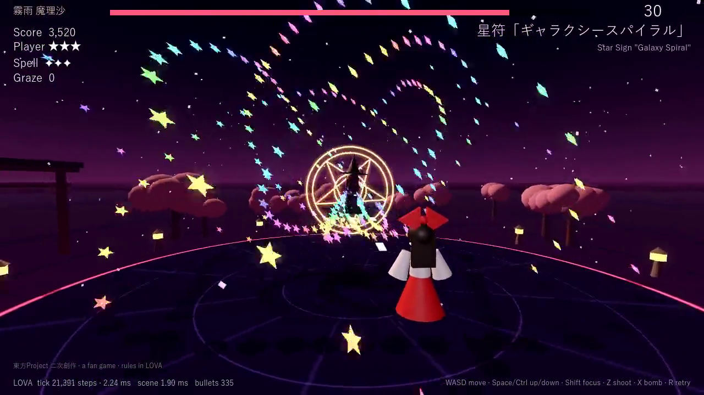

# 東方天球譚 -- a 3D danmaku duel in Godot, its rules in LOVA

    cargo build --release --manifest-path native/lova-godot/Cargo.toml
    python apps/godot/danmaku/build.py --run
    python apps/godot/danmaku/build.py --run --phase=1           # practice a spell card
    python apps/godot/danmaku/build.py --shot=out.png --phase=1 --at=420
    python apps/godot/danmaku/build.py --smoke                   # headless, ten seconds
    python apps/godot/danmaku/build.py --movie=apps/godot/danmaku/demo.mp4 --phase=1 --ticks=1200

[`demo.mp4`](demo.mp4): twenty seconds of the autopilot against the
second card, recorded in Godot's movie-maker mode, a frame a tick.

A Touhou Project fan game (東方Project 二次創作), in three dimensions:
the shrine maiden flies freely in a round arena of night sky -- left,
right, toward and away from the witch, up and down -- while the witch
at its centre throws three spell cards at her: shells of bullets in
every direction, five spiral arms whose pitch rides up and down so they
sweep the whole sphere, and big stars that fall from twenty metres.
She fires amulets back, grazes what passes close, and spends a bomb
when there is no way through.

| What | Where | Whose |
|---|---|---|
| The rules -- flight, bullets, hits, grazes, bombs, amulets, spell cards | `lib/danmaku.lova` | ours |
| What Godot is told after a tick | `danmaku_godot.lova` (`scene`, `start-at`) | ours |
| The runtime inside Godot | `native/lova-godot`, the `LovaRuntime` class | ours |
| Everything drawn and heard -- sky, arena, torii, cherry trees, the two figures, bullets, HUD, sound, music | `game/main.gd`, built in code | ours |

No asset in the project is anyone else's: the figures are built from
primitives, the sounds and the music are synthesised when the game
starts, and the tune is written for it.  A fan game may use the
characters; it may not take ZUN's pictures or music.

## Controls

| Key | |
|---|---|
| W A S D / arrows | toward the witch, circle left, away, circle right |
| Space / Ctrl (E / Q) | up / down |
| Shift | focus: slower, and the hitbox shows |
| Z (J, left mouse) | amulets |
| X (K, right mouse) | bomb |
| R | retry after a game over |

The camera stays behind the maiden and looks at the witch, so "left"
and "right" circle her and the aim is never the player's problem --
in three dimensions the dodging is hard enough.  Two cues give the
depth a flat screen loses: every bullet casts a shadow on the arena
floor, fainter the higher it flies, and a bullet within 2.5 m of her is
drawn larger and whiter.

## How the rules keep a tick cheap

A bullet is never moved.  It is born with an origin, a velocity, a fall
and a tick to die at, and where it is at tick `t` is a formula, so a
tick allocates nothing for the hundreds of bullets that simply fly on:
it keeps the ones whose time is not up and asks how near each is to the
maiden, giving up at the first axis that is out of reach.  A graze needs
no memory: a bullet grazes on the one tick its distance falls under the
graze radius.  A bullet lives until it is twenty metres from where it
was thrown, because past that it can reach nobody.

On the densest card (about 400 bullets) a tick is ~42 000 steps and
5-6 ms in the LOVA VM inside Godot, the `scene` call another 2-3 ms;
`bench.py` plays the whole duel and prints the cost as it goes.

## What the examples hold

The relations at the bottom of `lib/danmaku.lova`, checked by
`lova check` and `tests/test_danmaku.py`: the forty-eight-point shell
is a sphere; strafing left and right round a still witch ends at mirror
places (the first run of this relation caught `div` flooring the left
side one unit further than the right, as it did in Neon Alley); focus is
slower; the arena and the ceiling hold; the pause throws nothing; a
bullet on the maiden hits, one a metre off does not, and none does while
she is untouchable; a bomb clears the air and a held key spends one; a
bullet passing half a metre away grazes once, and so does a still one
she flies past; a bomb in the pause between cards leaves the witch's
health alone; retry leaves both a clear and a game over; a hit with no
spare life ends the game on that tick even if an amulet was about to
end the card; amulets hurt the witch.
